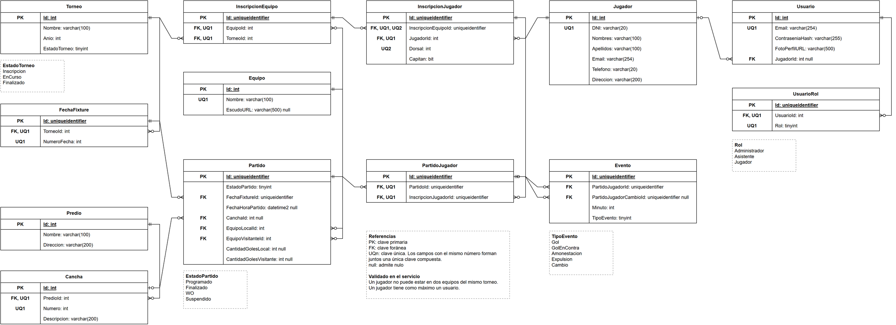

# LigaHub — Backend

Repositorio de Back-End del proyecto LigaHub para la materia Desarrollo de Software — Ingeniería en Sistemas de Información — UTN FRRo — 2026.

LigaHub es un sistema de gestión de torneos de fútbol: torneos, equipos, jugadores, inscripciones, generación del fixture y carga de resultados.

## Integrantes

| Nombre | Legajo | GitHub |
|:--|:-:|:--|
| Mateo Rindello | 47216 | [mateorindello1](https://github.com/mateorindello1) |
| Juan Urquiza | 54666 | [juan-urquiza3](https://github.com/juan-urquiza3) |

## Repositorios

- Backend: este repositorio.
- Frontend: [LigaHub-FE](https://github.com/mateorindello1/LigaHub-FE)

## Stack

| Capa | Tecnología |
|:--|:--|
| Lenguaje | TypeScript |
| Runtime | Node.js 24 LTS |
| Framework web | NestJS (sobre Express) |
| ORM | Prisma |
| Base de datos | SQL Server |
| Tests | Vitest + Supertest |
| Linter y formato | oxlint + Prettier |
| Gestor de paquetes | pnpm |

## Modelo de datos

El modelo está en [`docs/modelo-de-datos.drawio`](docs/modelo-de-datos.drawio) (editable con [draw.io](https://www.drawio.com/)), con una vista previa en [`docs/modelo-de-datos.png`](docs/modelo-de-datos.png).



## Requisitos

- [fnm](https://github.com/Schniz/fnm) (o cualquier gestor de versiones de Node). La versión está fijada en `.node-version`.
- [pnpm](https://pnpm.io/)

## Instalación

```bash
fnm use
pnpm install
```

## Scripts

| Comando | Qué hace |
|:--|:--|
| `pnpm start:dev` | Levanta la API en modo desarrollo, con recarga automática (puerto 3000 por defecto, o el de `PORT`) |
| `pnpm build` | Compila a `dist/` |
| `pnpm start:prod` | Ejecuta la versión compilada |
| `pnpm test` | Tests unitarios |
| `pnpm test:e2e` | Tests end-to-end |
| `pnpm test:cov` | Tests con cobertura |
| `pnpm lint` | Linter |
| `pnpm format` | Formatea el código con Prettier |
| `pnpm db:migrate` | Genera y aplica una migración a partir de los cambios en `prisma/schema.prisma` (desarrollo) |
| `pnpm db:deploy` | Aplica las migraciones pendientes, sin generar nuevas (producción) |
| `pnpm db:seed` | **Borra todos los datos** y carga los datos de demostración |
| `pnpm db:studio` | Abre Prisma Studio para ver y editar los datos |
